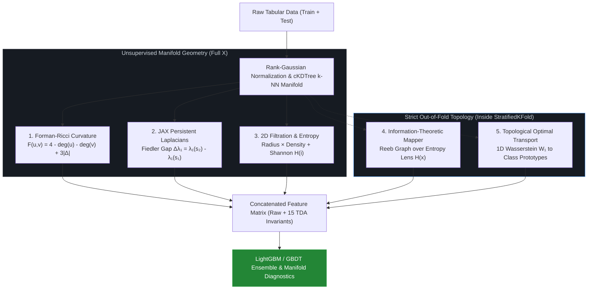

Math over brute compute: A modular, leak-free TDA engine for tabular ML combining Forman-Ricci Curvature, JAX Persistent Laplacians, 2D Filtration, Information Mapper &amp; 1D Optimal Transport.

## 🏗️ Pipeline Architecture

# 🌌 Multi-Scale Geometric & Spectral TDA Engine (JAX + LightGBM)

> **Math over brute compute.** A modular, leak-free Topological Data Analysis (TDA) feature engineering pipeline for tabular Kaggle competitions. Combines discrete Ricci curvature, JAX-accelerated Persistent Laplacians, 2D density-radius filtration, Information-Theoretic Mapper, and 1D Optimal Transport.

---

## 🧠 Mathematical Architecture

Standard Vietoris-Rips persistent homology suffers from $\mathcal{O}(N^3)$ computational complexity and captures only topological holes (Betti numbers), ignoring metric rigidity and local density variations. This engine extracts multi-scale geometric and spectral invariants on a sparse $k$-NN manifold:

### 1. Combinatorial Forman-Ricci Curvature
Models the dataset as a simplicial complex built over a $k$-NN graph $G = (V, E)$. For each edge $e = (u, v)$, discrete curvature is computed combinatorially via vertex degrees and shared 2-simplices (triangles $\triangle_{uv}$):

$$F(u, v) = 4 - \deg(u) - \deg(v) + 3 \cdot |\triangle_{uv}|$$

* **Positive curvature:** Dense cluster cores.
* **Negative curvature:** Narrow topological bridges, bottlenecks, and decision boundaries.

### 2. Spectral Topology via Persistent Laplacians (`JAX` Batched)
Constructs local Gaussian affinity matrices $W^{(s)}_{ij} = \exp\left(-\frac{\|x_i - x_j\|^2}{\sigma_s}\right)$ across two filtration scales ($s_1 < s_2$) for each point's $k$-neighborhood. Computes the **Fiedler value** $\lambda_1$ (the smallest non-zero eigenvalue of the combinatorial Laplacian $L^{(s)} = D^{(s)} - W^{(s)}$) and tracks its persistence gap:

$$\Delta \lambda_1 = \lambda_1(L^{(s_2)}) - \lambda_1(L^{(s_1)})$$

This captures local manifold stiffness and stretching invisible to standard homology.

### 3. Two-Parameter Filtration (Radius $\times$ Density) & Local Entropy
To suppress synthetic tabular noise and outliers, neighborhood edges are filtered jointly by Euclidean radius $r_{ij}$ and local density $\rho_i = \left(\frac{1}{k}\sum_{j=1}^k r_{ij}\right)^{-1}$:

$$\mathcal{N}_{\text{robust}}(i) = \lbrace j \in \mathcal{N}_k(i) \;\mid\; \rho_j \geq \alpha \cdot \rho_i \rbrace$$

Additionally computes row-wise Shannon Entropy $H(i) = -\sum_{j=1}^k p_{ij} \ln p_{ij}$ over normalized neighborhood distances $p_{ij} = r_{ij} / \sum_m r_{im}$.

### 4. Out-of-Fold Information-Theoretic Mapper (Reeb Graph)
Uses local Shannon entropy $H(x)$ as a topological lens function $f: X \to \mathbb{R}$ to construct an overlapping interval cover $\lbrace U_\alpha \rbrace$. Inside each cross-validation fold, Bayesian-smoothed target rates are projected onto validation and test manifolds via Gaussian kernel weights without target leakage.

### 5. Topological Optimal Transport (1D Wasserstein Signatures)
Represents each sample's local persistence profile as its sorted $k$-NN distance vector $\mathbf{d}_i \in \mathbb{R}^k$. Computes exact 1D Wasserstein distances $W_1(\mathbf{d}_i, \mathbf{\mu}_c)$ to class-conditional median persistence prototypes $\mathbf{\mu}_0, \mathbf{\mu}_1$ strictly inside CV folds.

---

## 🗂️ Modular Notebook Structure

The pipeline is split into **7 self-contained blocks** for rapid experimentation in Google Colab:

1. **`Block 1 — Configuration & JAX Setup`**: Hyperparameters (`CFG`) and hardware backend initialization.
2. **`Block 2 — Metric Manifold Skeleton`**: Rank-Gaussian normalization (`QuantileTransformer`) and parallel `cKDTree` construction.
3. **`Block 3 — Unsupervised Curvature & 2D Filtration`**: Forman-Ricci curvature, density-filtered radii, and Shannon entropy.
4. **`Block 4 — JAX Spectral Engine`**: `@jax.jit` + `jax.vmap` batched eigenvalue solver for Persistent Laplacians.
5. **`Block 5 — Leak-Free OOF Mapper & Wasserstein`**: Nested Out-of-Fold Reeb graph projection and 1D Optimal Transport.
6. **`Block 6 — 5-Fold CV Benchmark`**: Direct comparison between Raw Baseline and TDA-Enhanced `LightGBM`.
7. **`Block 7 — Manifold Diagnostics`**: 3-panel visualization of Forman curvature, Fiedler spectral plane, and feature gain.
